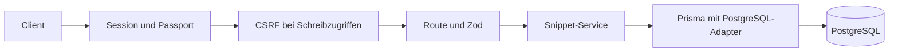
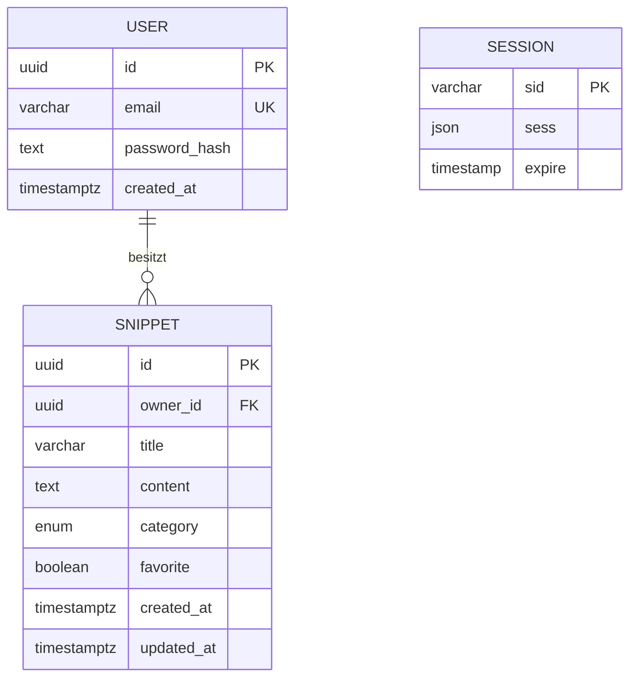

# Backend verstehen und selbst erweitern

## 1. Der Weg eines Requests



Beispiel: `PATCH /api/snippets/:id`.

1. `app.ts` liest JSON und lädt über das Cookie die Session aus PostgreSQL.
2. Passport liest die Nutzer-ID aus der Session und lädt den öffentlichen Nutzer.
3. Die CSRF-Middleware prüft Token und gegebenenfalls Browser-Origin.
4. `snippets/routes.ts` verlangt einen Login und validiert ID sowie Body.
5. `snippets/service.ts` ändert den Datensatz mit **ID und Besitzer-ID im selben Datenbankbefehl**.
6. Die Route gibt `{ data: snippet }` zurück. Express wandelt `Date`-Werte dabei in JSON-Zeitstempel um.

Die Route kennt HTTP, der Service bekommt bereits validierte Daten. Der Service verwendet für Fehler momentan eine kleine `HttpError`-Klasse. Für eine spätere vollständige Framework-Trennung könnte man eigene Fachfehler einführen und sie erst in der Route auf HTTP abbilden. Für diese kleine App würde eine zusätzliche Abstraktionsschicht wenig bringen.

**Lesereihenfolge:** `contracts/src/index.ts` → Prisma-Schema → Snippet-Routen → Service → Auth → `app.ts`.

## 2. Warum Create und PATCH verschiedene Schemas haben

Beim Anlegen sind Defaults sinnvoll:

```json
{ "title": "Logs", "content": "docker logs app" }
```

Zod ergänzt `category: OTHER` und `favorite: false`.

Beim Update wäre dieselbe Ergänzung ein Fehler: Ein Request mit nur neuem Titel würde sonst möglicherweise Kategorie und Favorit zurücksetzen. Deshalb hat `updateSnippetSchema` **optionale Felder ohne Defaults**. Zusätzlich muss mindestens ein Wert vorhanden sein.

Diese drei Fälle unterscheiden sich:

| Eingabe    | Bedeutung                                     |
| ---------- | --------------------------------------------- |
| Feld fehlt | Bisherigen Wert behalten                      |
| `false`    | Diesen Boolean ausdrücklich auf false setzen  |
| `null`     | Ungültig, da das Feld keinen Nullwert erlaubt |

Eine Abfrage wie `if (input.favorite)` wäre falsch: `false` würde übersprungen. Wir geben den validierten Patch direkt an Prisma weiter. Unbekannte Eigenschaften sind durch `z.strictObject` abgewiesen; ein Client kann so keine Besitzer-ID oder Zeitstempel einschleusen.

Bei Inhalt prüfen wir mit `trim()`, ob er nur aus Leerraum besteht, speichern aber den **Originaltext**. Ein direktes `.trim()` auf dem gespeicherten Code würde Einrückungen zerstören. Titel werden dagegen außen getrimmt.

Tests dazu: `packages/contracts/test/snippets.test.ts` und die PATCH-Gruppe in `apps/api/test/integration/api.test.ts`.

## 3. Datenmodell und Datenbankregeln



Sessions haben keinen Prisma-Fremdschlüssel zu Nutzern: `connect-pg-simple` verwaltet sein eigenes JSON-Format; Passport speichert die Nutzer-ID darin. Wurde ein Nutzer inzwischen entfernt, lehnt `deserializeUser` die Session beim nächsten Request ab.

- **UUID:** Prisma erzeugt die ID beim Anlegen. Die Migration setzt dafür keinen SQL-Default. Bei direktem SQL musst du eine ID selbst angeben.
- **E-Mail:** Zod normalisiert auf Kleinbuchstaben; die Datenbank erzwingt Eindeutigkeit und die normalisierte Form zusätzlich.
- **Fremdschlüssel:** Ein Snippet braucht einen existierenden Besitzer. Das bleibt auch bei direktem Datenbankzugriff gültig.
- **Cascade:** Beim bewussten Löschen eines Nutzers auf DB-Ebene verschwinden dessen Snippets. Die App bietet dafür keinen Endpunkt.
- **Kategorien als Enum:** Kleine feste Menge, ohne Kategorienverwaltung. Eine neue Kategorie braucht SQL-Migration **und** eine Anpassung des öffentlichen Schemas.
- **Zeitstempel:** `createdAt` wird initial gesetzt; Prisma pflegt `updatedAt` bei Prisma-Updates. Direkte SQL-Updates müssen `updated_at` selbst setzen; es gibt keinen Trigger.
- **Indizes:** Besitzer plus Änderungszeit/ID unterstützen die Standardliste; Besitzer plus Kategorie unterstützen den Kategorie-Filter. Die Teiltextsuche läuft für diese kleine Datenmenge ohne Volltextindex.

Zod ist die benutzerfreundliche Eingabeprüfung. SQL ergänzt zentrale Strukturregeln wie Pflichtfelder, Feldlängen, Fremdschlüssel und Eindeutigkeit. Die SQL-Checks sind bewusst kein vollständiges zweites Zod-Schema.

Die initiale Migration ist eingecheckt. `npm run db:migrate` führt `prisma migrate deploy` aus und wendet nur fehlende Migrationen an. Änderungen am Schema werden nicht automatisch in eine bestehende Datenbank übertragen.

Für eine spätere Schemaänderung, nach vorherigem Backup:

```powershell
npx prisma migrate dev --name add_language --config packages/database/prisma.config.ts
npm run build
```

Das ist ein Entwicklungsbefehl. Er kann für seine Shadow-Datenbank zusätzliche Rechte brauchen. Neue Migration vor dem Commit lesen; bestehende angewendete Migrationen nicht nachträglich umschreiben.

## 4. Besitzerprüfung ohne CASL

Auch bei einer persönlichen App übernimmt der Server den Besitzer ausschließlich aus der Session. Beispielhaft ist der Datenbankfilter `{ id, ownerId }`.

Ein fremdes und ein nicht existierendes Snippet ergeben beide `404`. Damit verrät der Endpunkt nicht, ob eine fremde ID existiert. Für die Tests werden zwei Nutzer angelegt, obwohl das Setup nur einen Besitzer provisioniert.

Das Update nutzt `updateManyAndReturn`: Prüfen und Ändern passieren in einem Befehl. Eine getrennte Folge „existiert und gehört mir?“ → „jetzt ändern“ hätte zwischen den Schritten ein Zeitfenster für konkurrierende Änderungen. Der gemeinsame Filter vermeidet diese Lücke. Löschen funktioniert analog über `deleteMany` und die Anzahl betroffener Zeilen.

## 5. Pagination, Suche und Transaktion

Die Tabellenansicht benötigt die aktuelle Seite **und** die Gesamtzahl. Ohne gemeinsamen Snapshot könnte zwischen beiden Abfragen ein Eintrag angelegt oder gelöscht werden. Deshalb laufen `findMany` und `count` in einer kurzen `RepeatableRead`-Transaktion.

Bei gleichen Sortierwerten entscheidet zusätzlich die UUID. Dadurch springen Einträge bei unveränderten Daten nicht zwischen Seiten. Unterschiedliche Requests haben trotzdem unterschiedliche Snapshots; bei vielen parallelen Änderungen wäre Cursor-Pagination eine spätere Option.

PostgreSQL verwendet `%` und `_` als Wildcards bei LIKE-Suchen. Wir maskieren diese Zeichen und Backslashes, damit eine Suche nach `100%` tatsächlich diesen Text meint. Prisma bindet die Werte als Parameter; Suchtext wird nicht zu SQL-Code.

Query-Booleans sind Strings. `Boolean('false')` wäre **true**. Deshalb akzeptiert das Schema ausschließlich `'true'` und `'false'` und wandelt sie ausdrücklich um.

## 6. Passport, Passwort-Hash und Session

1. Das Provisionierungsskript erzeugt mit Node `scrypt` und zufälligem Salt einen Hash. Es speichert kein Klartextpasswort.
2. Die Local-Strategie sucht den Nutzer und vergleicht den berechneten Hash mit `timingSafeEqual`.
3. Auch eine unbekannte E-Mail führt eine Hashprüfung gegen einen Dummy-Hash aus, um grobe Zeitunterschiede zu reduzieren.
4. `req.logIn` regeneriert die Sitzung. Die alte Session-ID wird dadurch nicht zur eingeloggten Session.
5. Im Cookie steckt eine signierte Session-ID. Sessiondaten liegen serverseitig in PostgreSQL; das ist kein JWT.
6. Passport speichert nur die Nutzer-ID als Identität und lädt auf folgenden Requests den öffentlichen Nutzer.
7. Logout zerstört die serverseitige Session. Ein vorher kopiertes Cookie funktioniert danach nicht mehr.

`HttpOnly` verhindert direkten Cookiezugriff per Browser-JavaScript. `SameSite=Lax` schränkt Cookie-Mitgabe zwischen Websites ein. In Produktion ist zusätzlich `Secure` aktiviert. Sessiondaten bleiben bei einem API-Neustart erhalten; der Login-Ratelimiter liegt dagegen im Prozessspeicher und wird beim Neustart zurückgesetzt. Für eine lokale einzelne Instanz ist das der gewählte Umfang.

## 7. Warum CSRF bei Cookie-Login dazugehört

Browser senden Cookies unter bestimmten Bedingungen automatisch mit. Ein Schreibrequest braucht deshalb zusätzlich einen zufälligen Token, der in der Session liegt und vom Client als `X-CSRF-Token` gesendet wird.

`GET /api/auth/csrf` liefert ihn. Nach Login wird wegen des Sessionwechsels ein neuer Token erzeugt und zurückgegeben. Die Tokenprüfung findet **vor** den Schreib-Routen statt. Zusätzlich werden gesendete Origins mit `WEB_ORIGIN` verglichen. CORS allein ersetzt diese Prüfung nicht.

Ein CLI-Client ohne Origin kann zugreifen, muss aber dieselben Cookies und Tokens verwenden. Die Login-Route ist ebenfalls geschützt.

## 8. Fehler behandeln und Ressourcen schließen

Express 5 reicht Fehler aus zurückgegebenen Promises asynchroner Routen an die Fehler-Middleware weiter. Callback-APIs von Passport und Sessions brauchen weiterhin explizites `next(error)`.

Die Middleware liefert konsistente JSON-Fehler. Validierungsfehler sind `400`, fehlender Login `401`, fehlende eigene Datensätze `404`. Unerwartete Fehler erscheinen als generische `500`-Antwort; interne Details gehen ins Serverlog.

Prisma und der Session-Store verwenden kleine eigene Connection-Pools. Beim Beenden stoppt der Server neue Verbindungen und schließt beide Ressourcen. Deshalb wird Prisma nicht nach jedem einzelnen Request getrennt.

## Kleine Erweiterungen zum Üben

1. **Sprache ergänzen:** optionales Snippet-Feld `language` mit Migration, Vertragsänderung und Tests für Create/PATCH.
2. **Beschreibung ergänzen:** unterscheide dabei „nicht ändern“, „leerer Text“ und gegebenenfalls „auf null setzen“ bewusst.
3. **Neue Kategorie:** Enum und SQL erweitern; der Integrationstest erkennt Unterschiede zur öffentlichen Kategorienliste.
4. **Konflikte erkennen:** eine Versionsnummer einführen und Updates nur bei passender Version zulassen. Das wäre eine Erweiterung gegenüber „letzter Schreibzugriff gewinnt“.

Eine Erweiterung nach der anderen in einen eigenen PR packen. Die vorhandenen PATCH- und Besitzer-Tests helfen, unbeabsichtigte Änderungen zu erkennen.

## Primärquellen zum Nachlesen

- [Prisma: PostgreSQL und Driver-Adapter](https://www.prisma.io/docs/orm/overview/databases/postgresql)
- [Express 5: Fehlerbehandlung](https://expressjs.com/en/5x/guide/error-handling/)
- [Passport: Sessions](https://www.passportjs.org/concepts/authentication/sessions/)
- [PostgreSQL: pg_dump](https://www.postgresql.org/docs/17/app-pgdump.html)
- [PostgreSQL: pg_restore](https://www.postgresql.org/docs/17/app-pgrestore.html)
